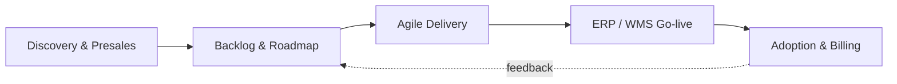

<!-- Profile README → lives in the repo Shafi18/Shafi18 -->
<h1 align="center">Shafik Mohamed R · Shafi</h1>

<b>IT Project Manager & SaaS Product Owner</b> · Abu Dhabi, UAE 
Agile delivery · ERP/WMS implementations · Digital transformation · Pre-sales

  
  
  
  

---

### Now
- 🚚 Owning a multi-platform **WMS & Spedition** SaaS product at Doodle Technologies
- 🤖 Automating CRM follow-ups and lead outreach with AI tooling
- 📘 Preparing for **PMP**

### Delivery footprint

<b>🏢 Experience</b> — click to expand

| Company | Role |
|---|---|
| **Doodle Technologies** | IT PM · SaaS Product Owner · Presales |
| Capgemini | <!-- add role --> |
| Guidehouse India | <!-- add role --> |
| Omega Health Care | <!-- add role --> |
| Infinite Computer Solutions | <!-- add role --> |

<b>🧰 Toolkit</b>

`Scrum` `Agile` `ERP` `WMS` `React` `TypeScript` `Vite` `GitHub Actions` `Claude` `Gemini` <!-- add your PM tools -->

<b>🎓 Education</b>

MCA — SRM University · BCA — Jamal Mohamed College

### Featured

| Project | What it is | Stack |
|---|---|---|
| [**Portfolio**](https://github.com/Shafi18/Portfolio) | Interactive portfolio with timeline, metrics and scheduler | React · TS · Vite |

### Activity

  <picture>
    <source media="(prefers-color-scheme: dark)" srcset="https://raw.githubusercontent.com/Shafi18/Shafi18/output/snake-dark.svg"/>
    
  </picture>

Contribution graph regenerated daily by GitHub Actions

